# AI Key Bridge

[](https://github.com/pdong15dth/gemini-default-ai-phone/releases/latest)
[](https://github.com/pdong15dth/gemini-default-ai-phone/releases)
[](https://github.com/pdong15dth/gemini-default-ai-phone/stargazers)
[](https://github.com/pdong15dth/gemini-default-ai-phone/actions/workflows/android.yml)
[](#cai-dat-va-thiet-lap)
[](LICENSE)

**Hô "Hi Jovi". Gemini trả lời.**

App Android mã nguồn mở thay trợ lý gốc của ROM (Tiểu V / Jovi trên Vivo OriginOS và các hãng khác) bằng **Google Gemini** — cả câu lệnh giọng nói lẫn nút cứng, tự bật Micro. Không root, không bắt buộc Trợ năng, không cần máy tính sau khi cài.

<p align="center">
  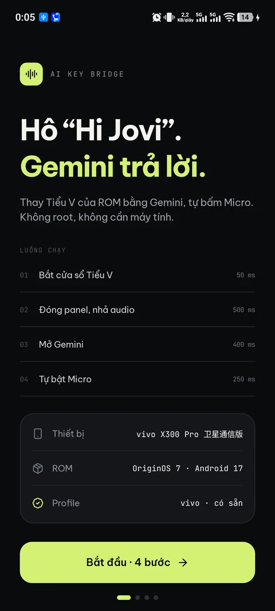
  &nbsp;
  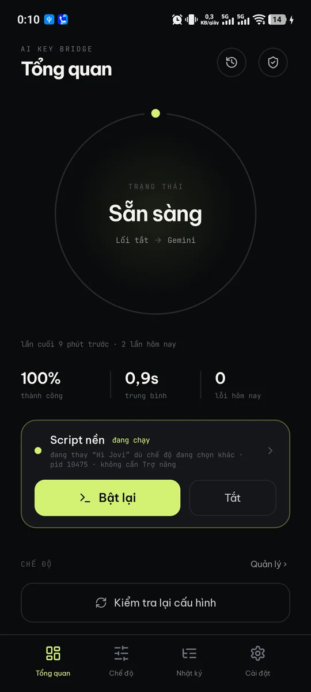
  &nbsp;
  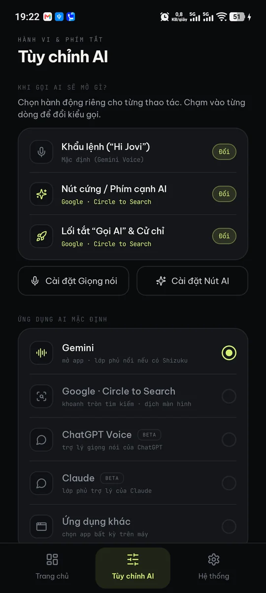
</p>

<p align="center">
  <a href="https://github.com/pdong15dth/gemini-default-ai-phone/releases/latest/download/ai-key-bridge.apk"><b>Tải APK</b></a>
  ·
  <a href="https://pdong15dth.github.io/gemini-default-ai-phone/"><b>Trang giới thiệu</b></a>
  ·
  <a href="HUONG-DAN-SCRIPT-ADB.md"><b>Dùng bằng script ADB (không cài app)</b></a>
</p>

> Android 11+ · không root · không quảng cáo · không thu thập dữ liệu. Đã kiểm chứng trên vivo X300 Pro (OriginOS 7, Android 17).

## Mục lục

- [Chức năng](#chuc-nang)
- [Cơ chế hoạt động](#co-che-hoat-dong)
- [Hãng được hỗ trợ](#hang-duoc-ho-tro)
- [Cài đặt và thiết lập](#cai-dat-va-thiet-lap)
- [Các màn hình trong app](#cac-man-hinh-trong-app)
- [Lưu ý trên OriginOS](#luu-y-tren-originos)
- [Báo lỗi](#bao-loi)
- [Cách khác: script ADB](#cach-khac-script-adb)
- [Tự build và deploy](#tu-build-va-deploy)
- [Cấu trúc repo](#cau-truc-repo)

<a name="chuc-nang"></a>

## Chức năng

| | Chức năng | Mô tả |
| --- | --- | --- |
| 🎙️ | **Thay "Hi Jovi"** | Bắt trợ lý gốc vừa hiện, đóng nó và mở Gemini thay thế — bằng script nền (không cần Trợ năng) hoặc Trợ năng. |
| 🔘 | **Nút cứng → AI** | Nút lối tắt / nút AI bên hông mở Gemini. Chế độ A bắt cửa sổ Tiểu V; chế độ B đọc event log nên Tiểu V không nháy lên. |
| 🎤 | **Tự bật Micro** | Tự chạm nút Micro sau khi Gemini mở, bạn nói luôn không cần chạm tay. |
| 🔒 | **Màn hình khóa** | Hô "Hi Jovi" khi máy đang khóa vẫn lên Gemini. |
| 🎯 | **Chọn đích** | Gemini, ChatGPT Voice, Claude hoặc bất kỳ app nào khác. |
| ⌨️ | **Lối tắt "Gọi AI"** | Gán vào chạm mặt lưng, khởi chạy nhanh, nút thông minh hoặc màn hình chính. |
| 🛠️ | **Kích hoạt & vá lỗi** | Chạy các lệnh cấu hình một lần qua Shizuku (hoặc copy lệnh ADB): đặt Google làm trợ lý mặc định, cho Tiểu V chạy nền, vá crash locale tiếng Việt. Mỗi lệnh đều đọc lại giá trị để xác minh. |
| 📜 | **Script nền** | Chạy đúng script trong [hướng dẫn ADB](HUONG-DAN-SCRIPT-ADB.md) bằng Shizuku — không cần Trợ năng. |
| 🔍 | **Dò trợ lý** | ROM chưa có profile? Bấm Dò rồi gọi trợ lý gốc, app lưu cửa sổ đó làm trigger. |
| 📊 | **Nhật ký** | Tỉ lệ thành công, thời gian chuyển hướng trung bình, biểu đồ 7 ngày. |
| 📦 | **Xuất log chẩn đoán** | Một file `.zip` gồm log app, lý do các lần app bị tắt, logcat và trạng thái hệ thống — gửi cho người phát triển khi gặp lỗi. |
| ↩️ | **Khôi phục mặc định** | Trả trợ lý về Tiểu V và bỏ mọi bản vá bằng một nút. |

<a name="co-che-hoat-dong"></a>

## Cơ chế hoạt động

```
"Hi Jovi" / nút AI ──► cửa sổ Tiểu V hiện ──► app biết (≈50 ms)
                                                   │
                                                   ▼
                                     Back: đóng panel, nhả audio (500 ms)
                                                   │
                                                   ▼
                                     Mở Gemini, Micro bật sẵn
```

App biết trợ lý gốc vừa mở bằng một trong hai cách, tuỳ chế độ:

- **Script nền** (khuyên dùng, không cần Trợ năng): script shell chạy bằng quyền shell của Shizuku, đọc kênh `events` của logcat và lọc đúng sự kiện `CopilotPanelWindow` / nút lối tắt. Gặp sự kiện thì bấm Back, đánh thức màn hình rồi gửi `keyevent 219` — lớp phủ Gemini hiện lên như khi giữ nút nguồn, khoanh tròn để hỏi được. Giống hệt cách trong [hướng dẫn script ADB](HUONG-DAN-SCRIPT-ADB.md), nhưng không cần máy tính. Script chạy riêng bằng quyền shell nên tắt Tuỳ chọn nhà phát triển, Gỡ lỗi USB, dừng Shizuku hay vuốt tắt app đều không làm script dừng; chỉ mất khi khởi động lại máy.
- **Đầy đủ**: **AccessibilityService** đọc *tên gói* và *tên lớp cửa sổ* vừa hiện. Khi Gemini mở, service đọc thêm tên và mô tả của các nút để tìm nút Micro rồi chạm.

Cả hai đều không đọc văn bản trên màn hình, không chụp màn hình, không ghi âm. App không có quyền Internet.

<a name="hang-duoc-ho-tro"></a>

## Hãng được hỗ trợ

| Hãng | Trợ lý gốc | ROM | Trạng thái |
| --- | --- | --- | --- |
| Vivo / iQOO | Tiểu V (Jovi) | OriginOS | ✅ Đã kiểm chứng |
| Honor / Huawei | YOYO / Celia | MagicOS | Beta |
| Nubia / RedMagic | Mora | MyOS | Beta |
| OPPO / OnePlus / Realme | Breeno | ColorOS | Beta |
| Xiaomi / Redmi / POCO | XiaoAI | HyperOS | Beta |
| Hãng khác | — | — | Dùng **Dò trợ lý** |

Profile beta lấy tên gói và tên cửa sổ từ thông tin công khai, chưa thử trên máy thật. Profile nằm ở [`android/app/src/main/assets/profiles/`](android/app/src/main/assets/profiles/) — rất mong bạn đóng góp profile cho máy của mình (xem [CONTRIBUTING.md](CONTRIBUTING.md)).

<a name="cai-dat-va-thiet-lap"></a>

## Cài đặt và thiết lập

### 1. Tải và cài APK

Tải [`ai-key-bridge.apk`](https://github.com/pdong15dth/gemini-default-ai-phone/releases/latest/download/ai-key-bridge.apk) và cài (cho phép cài từ nguồn không xác định). Cài sẵn **Google** và **Gemini** từ Play Store.

### 2. Chọn máy và cách dùng

<table>
  <tr>
    <td width="33%"></td>
    <td width="33%">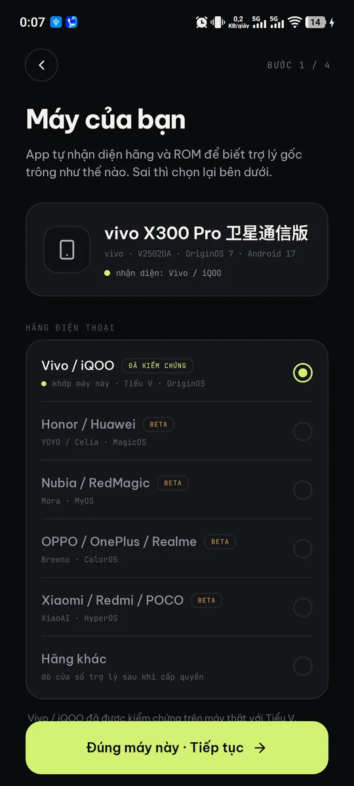</td>
    <td width="33%">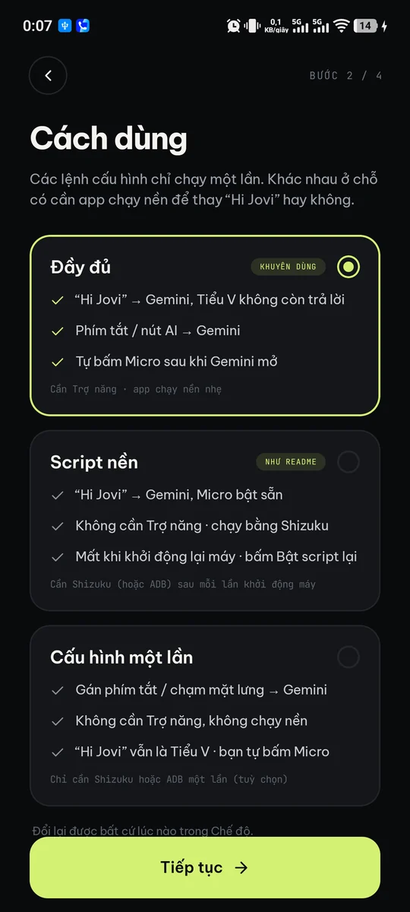</td>
  </tr>
  <tr>
    <td>Mở app, bấm <b>Bắt đầu</b>.</td>
    <td><b>Bước 1 — Máy của bạn.</b> App tự nhận diện hãng và ROM. Sai thì chọn lại.</td>
    <td><b>Bước 2 — Cách dùng.</b> Chọn một trong ba chế độ bên dưới.</td>
  </tr>
</table>

| Chế độ | Thay "Hi Jovi" | Nút / phím tắt | Tự bật Micro | Cần |
| --- | --- | --- | --- | --- |
| **Script nền** (khuyên dùng) | ✅ | ✅ | ✅ | Shizuku (bật lại sau mỗi lần khởi động máy) |
| **Đầy đủ** | ✅ | ✅ | ✅ | Trợ năng, app chạy nền nhẹ |
| **Cấu hình một lần** | ❌ (vẫn là Tiểu V) | ✅ | ❌ | Shizuku hoặc ADB một lần, không chạy nền |

Đổi chế độ bất cứ lúc nào trong tab **Chế độ**.

### 3. Cấp quyền và kích hoạt

<table>
  <tr>
    <td width="33%">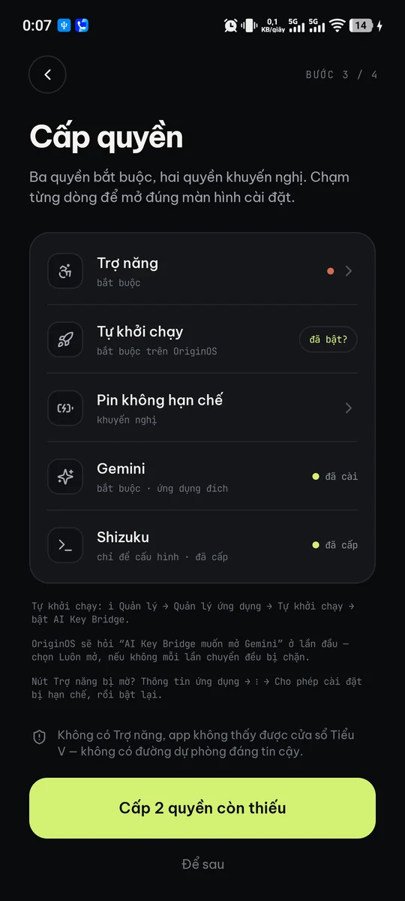</td>
    <td width="33%">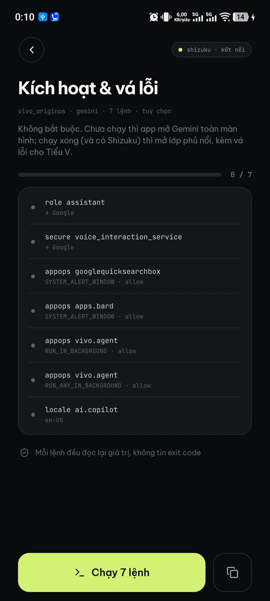</td>
    <td width="33%"></td>
  </tr>
  <tr>
    <td><b>Bước 3 — Quyền & Hướng dẫn bằng ảnh.</b> Chạm vào từng mục để mở thẳng màn hình cài đặt đó, hoặc bấm <b>Ảnh HD</b> để xem ảnh chụp màn hình khoanh vùng từng bước.</td>
    <td><b>Bước 4 — Kích hoạt & vá lỗi.</b> Có Shizuku thì bấm <b>Kích hoạt & Bật script nền</b>; không có thì bấm nút copy và dán lệnh ADB vào máy tính một lần.</td>
    <td>Trạng thái chuyển sang <b>Sẵn sàng</b>. Hô <b>"Hi Jovi"</b> để thử.</td>
  </tr>
</table>

#### Hướng dẫn trực quan các quyền cần bật (đã tích hợp sẵn trong app)

Ngay trong app (**Tổng quan → Quyền & Hướng dẫn bằng ảnh**), bạn có thể bấm để nhảy thẳng tới từng màn hình bên dưới mà không cần tự tìm trong Cài đặt:

<table>
  <tr>
    <td width="25%">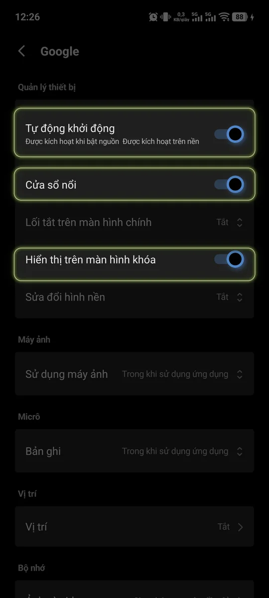</td>
    <td width="25%">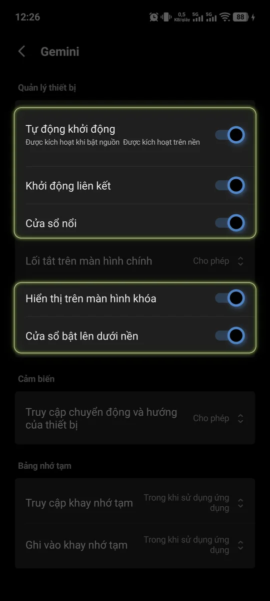</td>
    <td width="25%">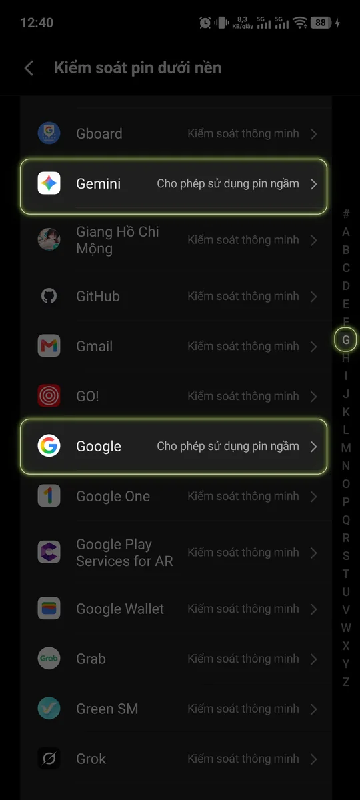</td>
    <td width="25%">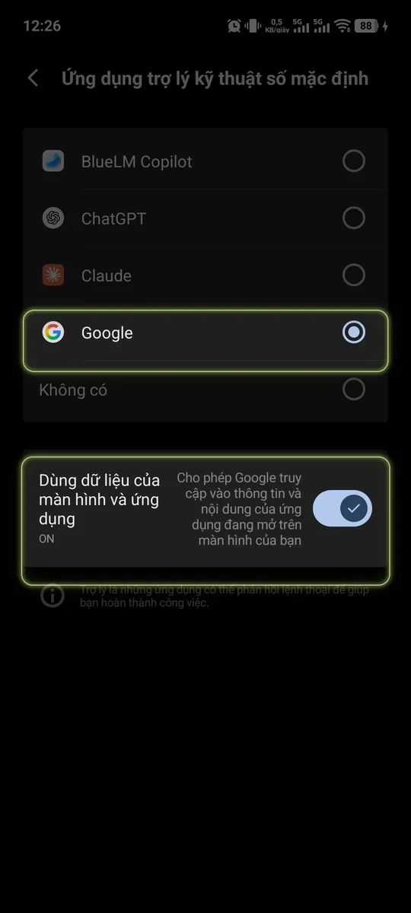</td>
  </tr>
  <tr>
    <td><b>1. Quyền của Google:</b> bật <i>Tự động khởi động</i>, <i>Cửa sổ nổi</i>, <i>Hiển thị trên màn hình khóa</i>.</td>
    <td><b>2. Quyền của Gemini:</b> bật đủ 5 mục <i>Tự động khởi động</i>, <i>Khởi động liên kết</i>, <i>Cửa sổ nổi</i>, <i>Màn hình khóa</i>, <i>Cửa sổ bật lên dưới nền</i>.</td>
    <td><b>3. Pin dưới nền:</b> bấm chữ <b>G</b> bên phải → chọn <b>Cho phép sử dụng pin ngầm</b> cho cả <b>Gemini</b> và <b>Google</b>.</td>
    <td><b>4. Trợ lý mặc định:</b> chọn <b>Google</b> và bật <b>Dùng dữ liệu của màn hình và ứng dụng</b>.</td>
  </tr>
  <tr>
    <td>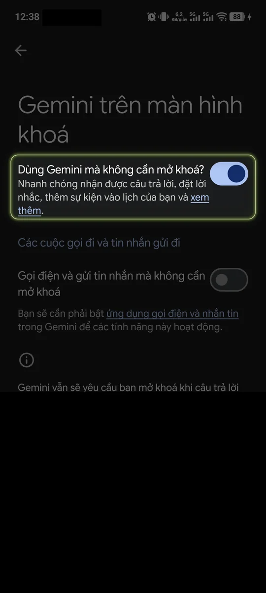</td>
    <td>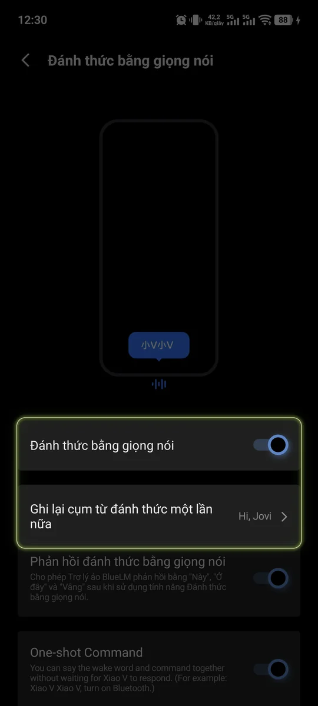</td>
    <td>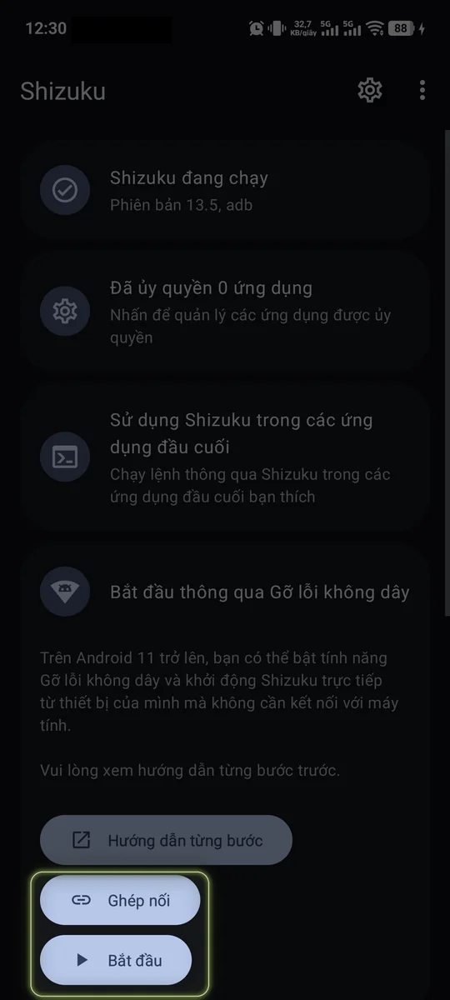</td>
    <td>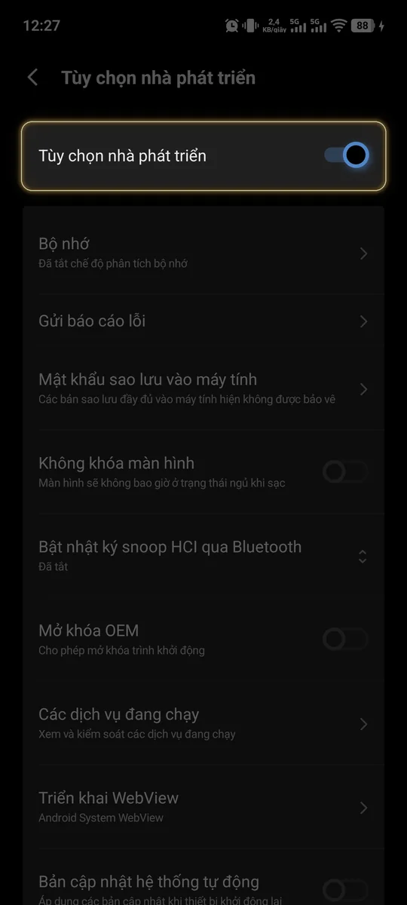</td>
  </tr>
  <tr>
    <td><b>5. Gemini trên màn khóa:</b> <i>Avatar Gemini → Cài đặt → Điều khiển thiết bị → Gemini trên màn hình khoá</i> → bật.</td>
    <td><b>6. Khẩu lệnh "Hi Jovi":</b> bật <i>Đánh thức bằng giọng nói</i> trong cài đặt Tiểu V / BlueLM.</td>
    <td><b>7. Shizuku:</b> <i>Ghép nối</i> & <i>Bắt đầu</i> qua Gỡ lỗi không dây để bật Script nền.</td>
    <td><b>8. Dùng app ngân hàng:</b> sau khi bật Script nền, tắt công tắc <i>Tùy chọn nhà phát triển</i>.</td>
  </tr>
</table>

> **Nút Trợ năng bị mờ?** Android 13+ chặn app cài ngoài: mở **Thông tin ứng dụng → ⋮ → Cho phép cài đặt bị hạn chế**, rồi quay lại bật.
>
> **Lần đầu chuyển hướng**, OriginOS hỏi "AI Key Bridge muốn mở Gemini" — chọn **Luôn mở**, nếu không lần nào cũng bị chặn.

### 4. Gán phím (tuỳ chọn)

<table>
  <tr>
    <td width="33%">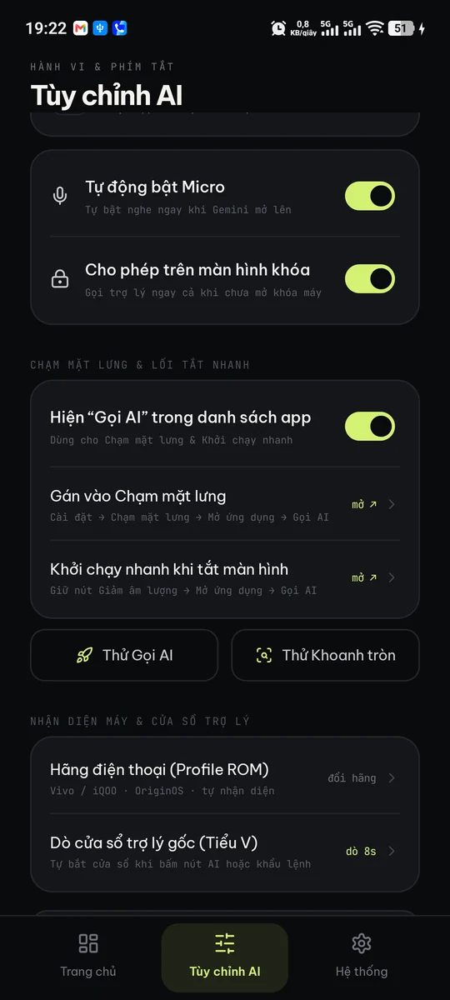</td>
    <td width="33%">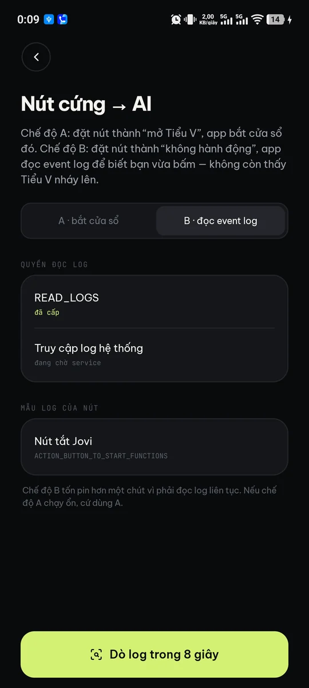</td>
    <td width="33%">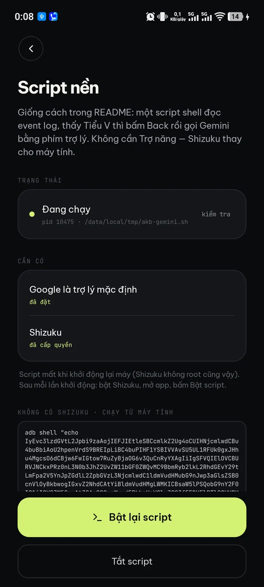</td>
  </tr>
  <tr>
    <td><b>Gán phím & lối tắt.</b> Gán lối tắt "Gọi AI" vào chạm mặt lưng, khởi chạy nhanh hoặc nút thông minh.</td>
    <td><b>Nút cứng → AI.</b> Chế độ B: đặt nút thành "không hành động", app đọc event log (cần quyền <code>READ_LOGS</code>).</td>
    <td><b>Script nền.</b> Bật/tắt script shell chạy bằng Shizuku, không cần Trợ năng.</td>
  </tr>
</table>

<a name="cac-man-hinh-trong-app"></a>

## Các màn hình trong app

<table>
  <tr>
    <td width="25%"></td>
    <td width="25%"></td>
    <td width="25%">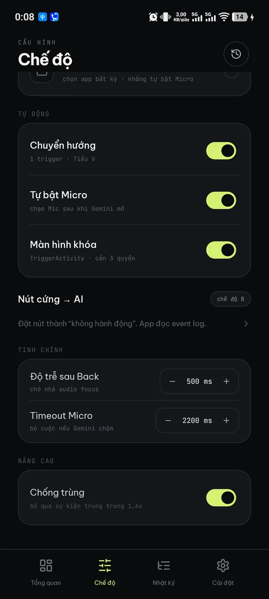</td>
    <td width="25%">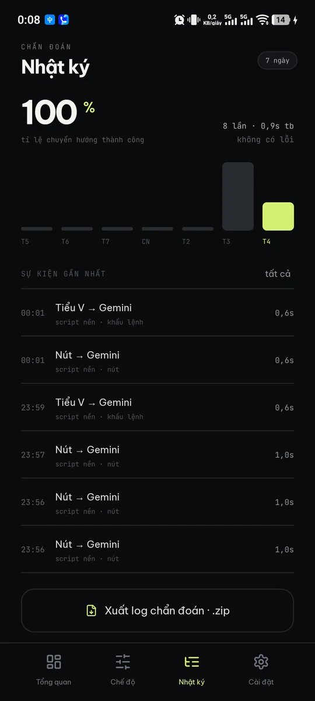</td>
  </tr>
  <tr>
    <td><b>Tổng quan</b> — trạng thái, số lần chuyển hướng, script nền.</td>
    <td><b>Chế độ</b> — cách dùng và ứng dụng đích.</td>
    <td>Bật/tắt chuyển hướng, tự bật Micro, màn hình khóa; tinh chỉnh độ trễ.</td>
    <td><b>Nhật ký</b> — tỉ lệ thành công, biểu đồ 7 ngày, sự kiện gần nhất.</td>
  </tr>
  <tr>
    <td>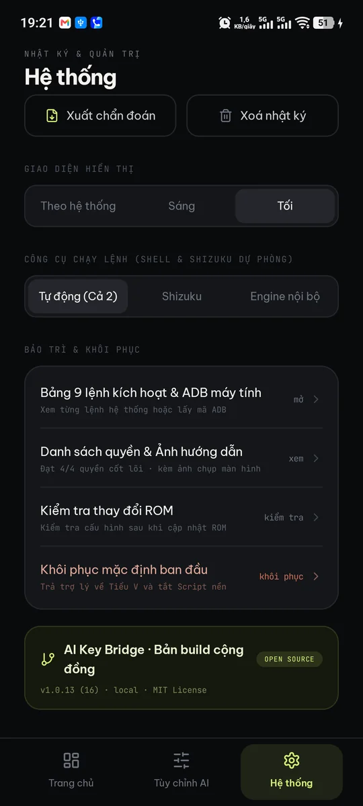</td>
    <td></td>
    <td>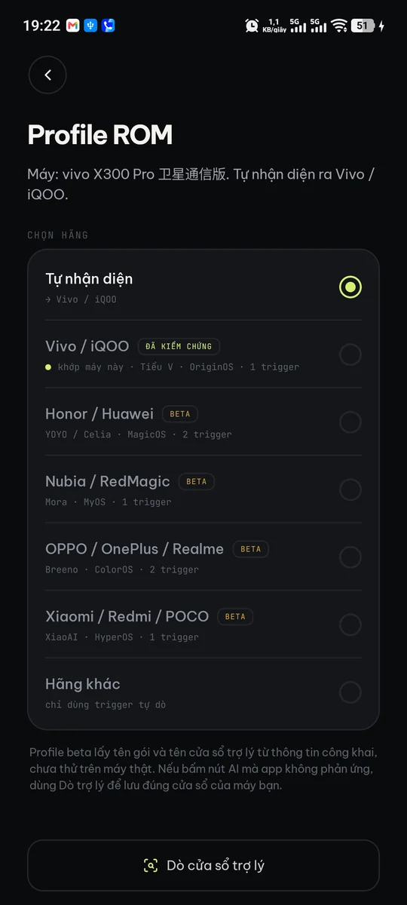</td>
    <td>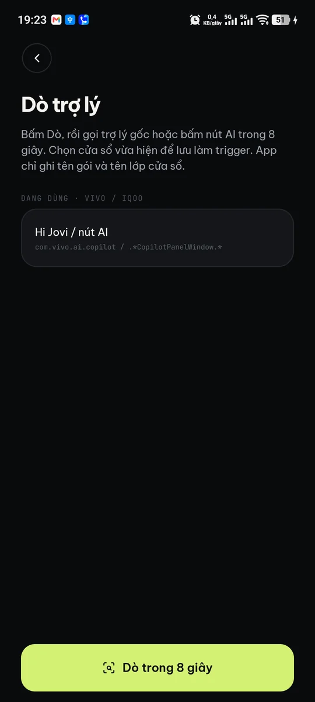</td>
  </tr>
  <tr>
    <td><b>Cài đặt</b> — thiết bị, quyền, kiểm tra thay đổi ROM.</td>
    <td>Xuất log chẩn đoán, xoá nhật ký, khôi phục mặc định.</td>
    <td><b>Profile ROM</b> — tự nhận diện hoặc chọn hãng.</td>
    <td><b>Dò trợ lý</b> — lưu cửa sổ trợ lý của máy bạn làm trigger.</td>
  </tr>
</table>

<a name="luu-y-tren-originos"></a>

## Lưu ý trên OriginOS

**Script nền** (khuyên dùng)

- Script chạy dưới quyền `shell` của Shizuku, tách khỏi app. **Vuốt app khỏi đa nhiệm hay kill app đều không ảnh hưởng** — "Hi Jovi" vẫn gọi Gemini.
- Script và Shizuku không root **mất khi khởi động lại máy**. Sau mỗi lần khởi động: bật lại Shizuku, mở app, bấm **Bật script**.
- Không cần Trợ năng, không cần Tự khởi chạy.

**Đầy đủ** (Trợ năng)

- **Khóa AI Key Bridge trong đa nhiệm.** Vuốt app khỏi màn đa nhiệm trên OriginOS là *force-stop*, và Android tự **tắt Trợ năng** của app bị force-stop — "Hi Jovi" sẽ ngừng hoạt động cho tới khi bạn bật lại Trợ năng. Mở đa nhiệm, kéo thẻ AI Key Bridge xuống (hoặc chạm biểu tượng khóa) để OriginOS không dọn nó.
- Bật **Tự khởi chạy**: *i Quản lý → Quản lý ứng dụng → Tự khởi chạy → bật AI Key Bridge*, để dịch vụ chạy lại sau khi khởi động máy.
- Không cần Shizuku lúc chạy — chỉ cần một lần để chạy lệnh kích hoạt (hoặc dán lệnh ADB).

<a name="bao-loi"></a>

## Báo lỗi

1. Vào **Cài đặt → Xuất log chẩn đoán** (hoặc **Nhật ký → Xuất log chẩn đoán · .zip**).
2. Có Shizuku thì file `.zip` kèm cả log toàn máy; không có thì chỉ có log của app.
3. Gửi file cho người phát triển, hoặc mở [issue](https://github.com/pdong15dth/gemini-default-ai-phone/issues/new/choose) mô tả lỗi.

| File trong `.zip` | Nội dung |
| --- | --- |
| `history.log`, `log.txt`, `attempts.txt` | Nhật ký của app (lưu xuống đĩa, không mất khi app bị tắt) |
| `exit-reasons.txt` | Các lần app bị tắt và lý do: vuốt khỏi đa nhiệm, ROM dọn RAM, crash… |
| `logcat-system.txt`, `system-state.txt` | Log toàn máy và trạng thái Trợ năng, trợ lý mặc định, quyền (qua Shizuku) |
| `device.txt`, `settings.txt`, `profile.json` | Thông tin máy, cài đặt và profile đang dùng |

> Log toàn máy có thể chứa tên app khác, tên Wi-Fi hay tài khoản. Chỉ gửi riêng cho người phát triển, đừng đăng công khai.

<a name="cach-khac-script-adb"></a>

## Cách khác: script ADB

Không muốn cài app? [HUONG-DAN-SCRIPT-ADB.md](HUONG-DAN-SCRIPT-ADB.md) hướng dẫn làm điều tương tự chỉ bằng ADB và một script shell chạy nền: đổi trợ lý mặc định, vá crash locale, script bắt `CopilotPanelWindow`, dùng khi màn hình khóa, xử lý sự cố.

Nếu từng chạy script rồi chuyển sang app, dừng script trước để không có hai lớp cùng bấm Back:

```bash
adb shell "pkill -9 -f gemini.sh; pkill -9 -f logcat"
```

<a name="tu-build-va-deploy"></a>

## Tự build và deploy

Hướng dẫn đầy đủ: [docs/build-va-deploy.md](docs/build-va-deploy.md).

```bash
cd android
./gradlew assembleDebug     # app/build/outputs/apk/debug/app-debug.apk
./gradlew assembleRelease   # bản R8 ~2 MB
```

- **APK phát hành:** đẩy tag `v*`, workflow [`android.yml`](.github/workflows/android.yml) build và gắn `ai-key-bridge.apk` vào GitHub Release. Nên cấu hình keystore cố định trong GitHub Secrets trước khi phát hành.
- **Trang giới thiệu:** nằm trong `web/`, workflow [`pages.yml`](.github/workflows/pages.yml) deploy lên GitHub Pages khi có thay đổi trong `web/` trên `main`.

<a name="cau-truc-repo"></a>

## Cấu trúc repo

```
.
├── android/                  # app Kotlin + Jetpack Compose
│   └── app/src/main/
│       ├── assets/profiles/  # profile ROM (JSON)
│       ├── java/com/aikeybridge/
│       └── res/xml/          # cấu hình AccessibilityService
├── web/                      # trang giới thiệu tĩnh, deploy GitHub Pages
├── docs/
│   ├── images/               # ảnh chụp màn hình app
│   ├── build-va-deploy.md    # build APK, ký, phát hành, Pages
│   ├── rut-cap-usb.md
│   └── spec-app.md
├── scripts/
│   └── gemini.sh             # script cho cách ADB thủ công
├── HUONG-DAN-SCRIPT-ADB.md   # hướng dẫn dùng bằng script ADB
├── CONTRIBUTING.md
├── LICENSE
└── README.md
```

## Giấy phép

[MIT](LICENSE). Dự án cá nhân, không liên quan đến Vivo, Google hay các hãng điện thoại được nhắc tới. Tự chịu trách nhiệm với máy của mình.
